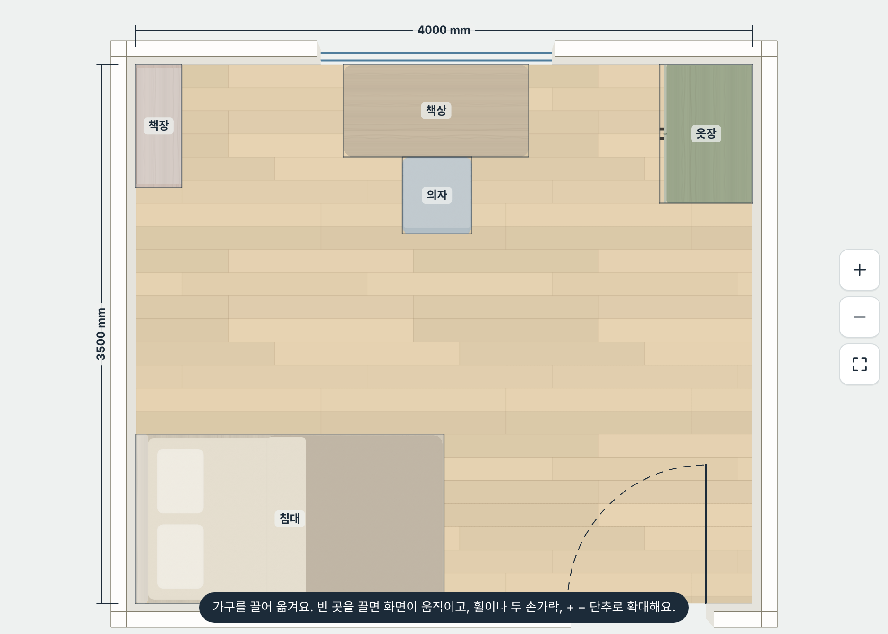
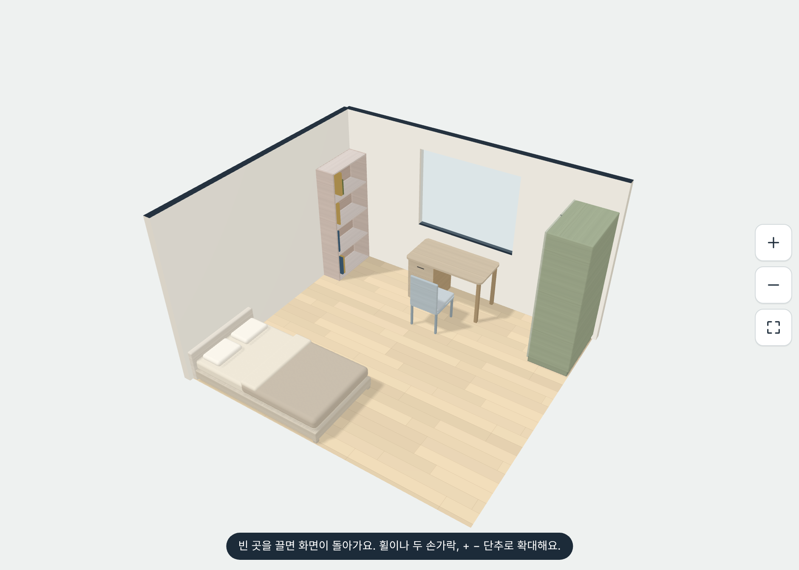
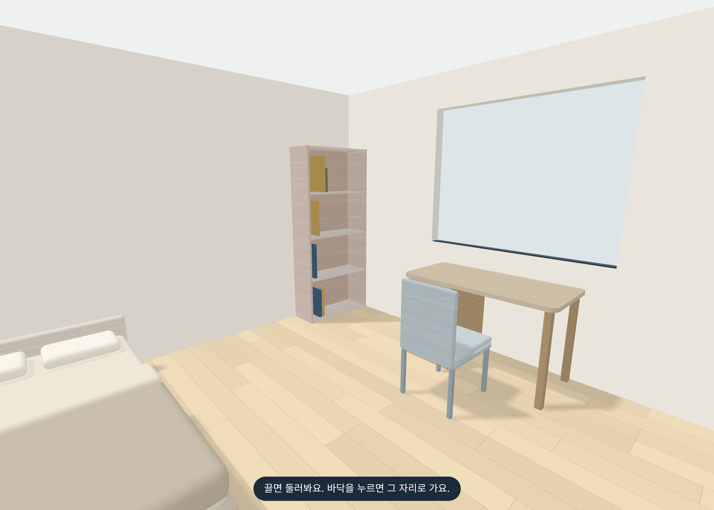

<!--
초안 사용법 (PDF로 만들기 전에 이 주석은 지운다)
- 숫자와 사례는 2026-11-19 낮 기준으로 저장소의 기록 파일과 git 이력에서 옮겼다.
- 【기입: …】은 본인만 아는 내용, 【확인: …】은 본인이 맞는지 봐야 하는 내용이다. 추정값을 넣지 말고 하지 않은 일은 문장째 지운다.
- 제출 조건(참가신청서 양식 기준): 표지 제외 5쪽 이상 10쪽 이내, 20MB 이하 PDF, 파일명 [분야]_팀명_생성형AI활용사례.pdf
- 블라인드 심사: 성명, 학번, 연락처, 계정명, GitHub 저장소 주소를 본문과 캡처 어디에도 넣지 않는다.
- 그림 3장은 images/ 폴더의 plan.png, 3d.png, walk.png 이다.
-->

# 【프로젝트 분야】 가구를 옮기며 내 집에 맞는지 알고 싶을 때

치수를 넣으면 방과 가구를 3D로 미리 배치해 보는 웹앱을 AI 에이전트 다섯에게 나눠 맡겨 만들고 결과는 만들지 않은 AI에게 판정시킨 기록

결과물: https://room-planner-3d-woad.vercel.app/ (로그인 없이 열림)

## 1. 활용 배경 및 문제 정의

이번에 집을 이사하면서 중고 거래 앱(당근)과 쇼핑몰에서 가구를 하나씩 골라 사기 시작했다. 그때마다 같은 고민을 했다. "이게 우리 집에 오면 어울릴까, 치수에 맞게 들어갈까." 판매 글의 치수와 내 방을 머릿속으로만 맞춰 보다 보니 실패도 있었다. 치수를 잘못 재서 집과 어울리지 않는 물건을 중고로 산 적이 있고 시스템 행거를 샀는데 높이가 맞지 않아 남는 높이를 책으로 메워 조립한 적도 있다.

사기 전에 확인할 방법을 찾아보았지만 기존 3D 배치 서비스는 "내 가구를 내 치수대로" 놓기가 어려웠다.

- IKEA Kreativ는 자사 제품을 놓아 보는 방식이라 사용자가 가구 치수를 넣는 단계가 없고 방을 만든 뒤 치수를 고치는 기능은 제공 예정으로 안내되어 있다([IKEA 고객센터](https://www.ikea.com/ie/en/customer-service/knowledge/articles/28c782c5-0036-4ff1-b1fd-20846237ee09.html)).
- Planner 5D는 가구 전체를 쓰려면 유료 구독이 필요하다는 불만이 이용자 후기에서 자주 보였다([Capterra 후기](https://www.capterra.com/p/164022/Planner-5D/reviews/)).
- 중고 가구는 어느 카탈로그에도 없다. 판매 글에 적힌 가로·세로·높이 숫자가 전부다.

그래서 가구 카탈로그 없이 치수만 넣으면 방과 가구가 3D로 그려지는 웹앱을 직접 만들기로 하였다. 방과 가구의 치수를 mm, cm, m 중 편한 단위로 넣고 가구를 방 안에서 끌고 돌려 보며 겹침, 벽까지의 거리, 천장 높이와의 관계를 미리 확인하는 것이 목표다.

문제는 이것을 혼자서, 공모전 마감까지 남은 일주일 안에 만들어야 한다는 점이었다. 생성형 AI에게 "앱을 만들어 달라"고 통째로 맡기는 대신, 일을 폴더 단위로 나눈 다섯 에이전트에게 위임하고 결과의 통과 여부는 코드를 만들지 않은 별도 에이전트가 숫자로 판정하게 하였다. AI끼리 서로의 결과를 확인하게 하고 그 구조가 놓친 것은 내가 직접 써 보며 잡아냈다. 아래에 그 과정을 적었다.

## 2. 사용한 생성형 AI 도구 및 선택 이유

| 도구 | 용도 | 선택 이유 |
| --- | --- | --- |
| Claude (대화) | 공모전 조건 분석, 에이전트 구성 설계, 프롬프트 초안 작성 | 긴 공지문과 조사 자료를 한 번에 놓고 설계 근거를 출처와 함께 정리하는 데 적합 |
| Claude Code (헤드 세션 1개 + 하위 에이전트 5개) 【확인: 실제 사용한 제품·요금제 표기】 | 코드 작성, 위임, 테스트 실행, 검증 | 하위 에이전트가 각자 별도의 맥락에서 실행되어 만드는 쪽과 판정하는 쪽을 분리할 수 있음. 프롬프트가 파일이어서 수정 이력이 남음 |
| Claude (앱 안에서 호출) | 손그림 배치도 읽기, 목적에 맞는 가구 배치 추천 | 손글씨 숫자를 읽어 그림과 대조하는 일과 배치 이유를 글로 설명하는 일은 규칙 코드로 만들기 어려움. AI의 답은 앱이 검사하고 사용자가 확인한 뒤에만 반영 |
| git | 프롬프트와 코드의 변경 이력 보관 | 언제 무엇이 바뀌었는지가 자동으로 기록되어 활용 과정의 증빙이 됨 |
| Vercel (무료 요금제) | 결과물 공개 | 로그인 없이 주소만으로 열어 볼 수 있고 AI를 부르는 작은 서버 함수 둘을 함께 올릴 수 있음 |

에이전트를 여럿 두는 구조는 빠르거나 싸지 않다. Anthropic은 멀티 에이전트가 같은 작업에 토큰을 보통 3~10배 쓴다고 밝히며 기획·구현·테스트처럼 일의 종류로 나누면 인계마다 맥락이 깎여 역효과가 나기 쉽다고 적는다([Anthropic, 2026-01-23](https://claude.com/resources/articles/building-multi-agent-systems-when-and-how-to-use-them)). 그래도 이 구조를 고른 이유는 같은 글이 효과를 인정한 두 가지, 맥락의 분리와 검증 전용 에이전트에 있다.

## 3. 핵심 프롬프트 및 활용 과정

### 0단계. 프롬프트 초안을 받아 그대로 커밋

만들고 싶은 것을 한 문단으로 적어 공모전 공지와 함께 Claude에 주고 에이전트 구성을 설계하게 하였다.

```text
[처음 준 요청. 프로젝트 설명에 적은 문장 그대로]

웹사이트나 어플리케이션을 제작해 방을 사진으로 찍고 규격을 입력하면
(mm ,m, cm 자유롭게 변환가능) 3D 로 방 구조를 확인하여 구현하고
내가 원하는 가구들의 규격을 입력하여 방에 미리 배치해보는것
```

받은 것은 헤드 프롬프트 1개, 하위 에이전트 프롬프트 5개, 공유 규약 파일 1개의 초안과 그 설계 근거였다. 이 과정에서 요청이 한 군데 좁혀졌다. 방 사진에서 구조를 자동으로 추정하는 방식은 검증된 방법을 조사에서 찾지 못해 범위 밖으로 두었다. 대신 직접 써 본 뒤, 치수를 적은 손그림 배치도를 AI가 읽는 기능은 더하기로 하였다. 사진에서 치수를 추정하는 것과 적혀 있는 숫자를 읽는 것은 다른 일이라고 보았기 때문이다.

초안은 고치지 않은 상태로 첫 커밋에 남겼다. 그 뒤 프롬프트 파일이 바뀐 것은 공유 규약의 소유 폴더와 서버 관련 문장뿐이고 모두 헤드 에이전트가 고쳤다. 내가 프롬프트 파일을 직접 고친 일은 없다. 나는 프롬프트 대신 결과물을 써 보고 지시를 내리는 쪽으로 개입했다(5단계).

### 1단계. 모든 에이전트가 읽는 공유 규약

```text
[공유 규약 원문 발췌, CLAUDE.md]

- 저장과 계산은 전부 정수 mm. cm와 m는 화면 표시와 입력 해석에만 쓴다.
- 문자열 ↔ mm 변환은 src/contracts/units.ts의 함수만 쓴다.
  다른 곳에서 10, 100, 1000을 곱하거나 나누지 않는다.
- three.js 장면은 1 unit = 1 m.
  mm ↔ 장면 좌표 변환은 src/contracts/coords.ts의 함수만 쓴다.
- 자기 소유 경로 밖의 파일은 읽기만 한다. 고쳐야 할 것 같으면
  보고서의 "계약·공유 파일 변경 요청"에 적는다.
- 테스트를 통과시키려고 값을 하드코딩하거나 테스트를 약하게 만들지 않는다.
```

"다른 곳에서 10, 100, 1000을 곱하거나 나누지 않는다"를 가장 중요하게 보았다. 내가 겪은 실패가 바로 치수 실수였기 때문이다. 단위 변환이 여러 파일에 흩어지면, 한 에이전트는 mm로 쓰고 다른 에이전트는 m로 읽어도 화면에는 그럴듯한 방이 그려진다. 변환이 일어나는 곳을 두 파일로 못 박아 두면 어긋남을 찾을 곳도 두 군데로 줄어든다. 이 두 파일과 그 테스트는 헤드가 가장 먼저 만들었다.

### 2단계. 폴더 단위로 나눈 역할

| 에이전트 | 맡는 일 | 소유 폴더 | 위임 횟수 |
| --- | --- | --- | --- |
| 헤드 | 사용자와의 대화, 위임, 통합, 공유 파일과 서버 함수 작성 | `src/contracts/`, `src/store/`, `src/app/`, `api/` | (위임하는 쪽) |
| spec-report | 요구사항과 완료 기준, 보고서용 사실 정리 | `docs/SPEC.md`, `docs/submission/` | 4 |
| room-input | 치수 입력, 단위 전환, 배치도 읽기, 저장, 벽·문 편집 | `src/ui/`, `src/room/`, `src/photo/` 등 | 11 |
| scene-engine | 평면·3D·사람 뷰 그리기, 포인터 위치를 방 좌표로 변환 | `src/scene/` | 15 |
| furniture-placement | 가구 입력, 이동·회전, 겹침·거리 계산, AI 추천 배치 | `src/furniture/`, `src/suggest/` | 11 |
| qa-verifier | 완료 기준 대조, 전체 테스트 실행, 수치 검증. 앱 코드는 고치지 않음 | `tests/e2e/`, `docs/reports/qa/` | 6 |

"기획자, 구현자, 테스터"처럼 일의 종류로 나누지 않았다. 그렇게 나누면 한 기능이 세 번 인계되고 그때마다 맥락이 줄어든다. 폴더로 나누면 한 에이전트가 자기 폴더의 구현과 단위 테스트를 함께 맡고 누가 범위를 벗어났는지는 `git status` 한 번으로 확인된다. 하위 에이전트끼리는 직접 대화하지 않고 모든 인계는 보고서 파일로 남는다.

이 경계가 늘 지켜지지는 않았다. 헤드가 급한 결함 수정이나 한두 줄 변경을 다른 에이전트의 폴더에서 직접 한 일이 11-18까지 기록상 24건이다. 그리고 마지막 날(11-19)의 보완 작업은 시간을 줄이려고 내가 허락해서 헤드가 폴더 경계 없이 직접 하였다.

### 3단계. 위임 메시지 양식

```text
[프롬프트 원문. 헤드가 하위 에이전트에게 일을 맡길 때 채우는 양식]

[task-id]   예: T-012
[목표]      이 작업이 끝나면 사용자가 할 수 있게 되는 것. 한두 문장
[범위]      만들거나 고칠 파일·폴더 (소유 경로 안)
[읽을 것]   docs/SPEC.md의 절, docs/CONTRACT.md의 절, 관련 src/contracts/ 파일, 앞선 보고서 경로
[쓸 수 있는 인터페이스]  store 액션, contracts 함수, 다른 모듈이 내보낸 컴포넌트 이름
[완료 기준] 확인 가능한 문장 3~7개. 입력 예와 기대 결과를 포함
[실행할 검증]  npm run typecheck, npm run test 등
[하지 않을 것]  이번 범위 밖의 기능, 손대면 안 되는 파일
[보고]      docs/reports/<task-id>.md, CLAUDE.md의 보고 양식

채울 수 없는 항목이 있으면 아직 맡길 준비가 안 된 것이다.
```

마지막 줄은 보내기 전에 스스로 걸러 내려고 넣었다. 하위 에이전트는 사용자와의 대화를 보지 못하고 위임 메시지와 공유 규약만 받는다. [완료 기준]을 입력 예와 기대 결과로 쓰게 한 것도 끝났는지를 실행 결과로 판단하려는 장치다. 에이전트가 "끝났다"고 말하는 것만으로는 판단하지 않았다.

위임은 11-18까지 47번이었다. 처음 다섯 번은 메시지 전문을 `docs/log/PROMPT_LOG.md`에 적었고 그 뒤는 요지와 결과만 적었다. 전문이 남지 않은 것은 이 기록의 빈틈이다. 각 위임의 결과는 에이전트가 쓴 작업 보고서로 남아 있다.

실제 위임 한 건을 옮긴다. 치수 입력 칸이 잘못된 값을 부모 화면에 알리게 하는 작업이다.

```text
[목표] 가구 추가 폼이 "칸에 잘못된 값이 들어 있는 동안에는 추가하지 않는다"를
       구현할 수 있도록, LengthInput이 자기 칸의 거부 상태를 부모에게 알린다.
[범위] src/ui/LengthInput.tsx, src/ui/LengthInput.test.tsx
[하지 않을 것] 다른 파일 수정, 기존 props와 문구 변경.
```

에이전트는 완료 기준 4개를 충족하고 테스트 19개를 더하였다. 그리고 실제 브라우저로 확인하다가 요청하지 않은 결함을 찾았다. 오류 문구가 나타나거나 사라지면 그 아래 버튼이 밀려서, 오류를 고친 직후 누른 "추가"의 클릭이 사라진다는 것이다. 헤드는 오류 문구 자리를 항상 비워 두는 방법으로 정해 같은 에이전트에게 다시 맡겼고 에이전트는 한 줄을 비워 두라는 지시가 320px 폭에서는 부족하다는 것을 측정으로 찾아 두 줄로 바꾸었다(수정 전 클릭 0건, 수정 후 1건).

반대 방향의 사례도 있다. 헤드가 공유 계약에 회전 버튼의 방향을 "시계 90도"라고 잘못 적었는데 맡은 에이전트가 기존 완료 기준과 테스트는 반시계라는 것을 찾아 코드는 기준대로 두고 불일치를 보고하였다. 헤드가 계약을 고쳤다.

### 4단계. 만들지 않은 에이전트의 판정

```text
[프롬프트 원문 발췌, qa-verifier]

- src/를 포함한 그 밖의 모든 경로는 읽기만 한다. 문제를 찾아도 고치지 않는다.
  만든 쪽과 판정하는 쪽이 같아지면 검증의 의미가 없어진다.
- 숫자가 먼저다. CONTRACT의 테스트용 조회 함수로 방과 가구의 위치·크기를 mm로 읽어
  기대값과 비교한다. 단위와 좌표계 오류는 화면으로는 그럴듯해 보여도 숫자에서 드러난다.
- 실패해야 하는 입력이 실제로 실패하는지 확인한다: 0이나 음수 치수,
  글자가 섞인 치수, 방보다 큰 가구, m로 쓴 값을 mm 칸에 넣은 경우, 형식이 틀린 JSON 가져오기.
- 문제가 없으면 없다고 적는다. 뭔가를 찾아내야 한다는 이유로 문제를 만들지 않는다.
```

"숫자가 먼저다"와 "문제가 없으면 없다고 적는다"를 짝으로 넣었다. 앞의 조건은 3D 화면의 특성 때문이다. 가구가 1000배 크거나 반대 방향으로 돌아가 있어도 스크린샷 한 장으로는 알아차리기 어렵다. 뒤의 조건은 반대쪽 실패를 막는다. 빈틈을 찾으라는 지시만 받은 검증자는 멀쩡한 결과에도 무언가를 지적한다.

검증 에이전트가 찾은 앱 결함은 모두 9건이고(11-17에 4건, 11-18 전수 검증에서 5건) 모두 고쳤다. 대표 4건이다.

| 발견일 | 완료 기준 항목 | 기대한 결과와 실제 결과 | 수정 |
| --- | --- | --- | --- |
| 11-17 | 처음에 방 전체가 보인다 | 기대: 뷰 전환 버튼이 방 바닥을 가리지 않음. 실제: 휴대폰 화면에서 약 1551×198 mm를 가려 그 자리의 가구를 잡을 수 없음 | 헤드, 재검증 통과 |
| 11-17 | 평면 뷰에서 끌면 칸막이 벽이 생긴다 | 기대: 바깥 벽 위에서 끌기 시작해도 칸막이가 생김. 실제: 칸막이는 안 생기고 바깥 벽이 선택됨 | 헤드, 재검증 통과 |
| 11-18 | 사람 뷰에서는 편집하지 않는다 | 기대: 사람 뷰에서 가구 추가·이동이 안 됨. 실제: 버튼과 방향키로 가구가 추가되고 움직임 | 11-18 수정, 시험 추가 |
| 11-18 | 되돌리기는 한 동작씩 | 기대: 직전 끌기만 취소. 실제: 연달아 한 두 번의 끌기가 한 단계로 묶여 함께 취소됨 | 11-18 수정, 시험 추가 |

결함은 대부분 두 부분이 만나는 자리에서 났다. 화면 조립과 버튼 위치, 버튼 포커스와 키보드 단축키, 새 화면(사람 뷰)과 기존 편집 기능이 그 예다. 단위 변환, 좌표, 경계값을 보는 수치 항목에서는 검증 에이전트가 결함을 찾지 못했다. 공유 규약으로 단위와 좌표를 묶어 둔 곳에서는 결함이 나오지 않았고 문제는 에이전트들의 결과물이 맞닿는 곳에서 나왔다.

11-18의 전수 검증은 완료 기준 87개를 다시 대조해 86개 통과(남은 1개는 당시 공개 주소가 없던 것)로 판정하였고 그와 별도로 "처음 쓰는 사람" 관점의 보완점 13개와 부족한 기능 7개를 적어 냈다. 이 목록이 마지막 날 작업의 할 일이 되었다.

### 5단계. 사람이 직접 한 일

기록에 남은 나의 일은 네 가지다. 만들 것과 뺄 것을 정하는 일, 중간 결과물을 컴퓨터와 휴대폰에서 직접 써 보는 일, 치수를 적은 배치도를 손으로 그려 실제 입력으로 넣어 보는 일, 그리고 AI의 결정이 내 기대와 다를 때 되돌리는 일이다. 내가 AI의 결정이나 결과를 바꾸게 한 것은 11-17까지 기록상 9번이다. 그중 세 가지를 적는다.

- 3D 화면에서 가구가 안 옮겨짐. 헤드는 "3D 화면에서는 가구를 선택만 한다"고 정해 두었고 자동 검증도 통과한 상태였다. 직접 써 보니 당연히 끌릴 줄 알았던 가구가 움직이지 않았다. 결함은 아니었다. AI의 결정이 내 기대와 어긋난 것이어서 결정을 뒤집게 하였다.
- 기본 가구가 누르자마자 생김. 다른 AI 검토자의 지적을 따라 "버튼을 누르면 바로 넣기"로 바꾼 동작이었다. 소파를 누르고 침대를 누르니 둘 다 그냥 생겨서, 미리보기로 보여 주고 ✓와 ✗로 확정하게 다시 바꾸게 하였다.
- 자동 검증을 통과한 사진 읽기가 실제 화면에서는 항상 실패. 휴대폰에서 사진을 올리니 "이 화면에서는 사진을 바로 읽을 수 없어요"만 떴다. 테스트가 AI 호출을 실제와 다른 모양의 가짜로 바꿔 놓고 통과시킨 것이 원인이었다. 고친 뒤에는 내가 그린 배치도(방 7.5 m × 5.7 m)가 4.5 m × 5.0 m로 읽혔다. 손글씨 7을 잘못 읽은 것이어서 AI에게 주는 지시문을 "적힌 숫자를 먼저 전부 옮겨 적고 그림의 비율과 대조한다"로 다시 쓰게 하였다. 【확인: 고친 뒤 같은 그림으로 다시 읽어 본 결과를 한 문장 덧붙인다】

같은 종류의 일이 공개 배포에서도 한 번 더 있었다. 서버 함수는 단위 테스트를 모두 통과했지만 실제 배포 주소에서는 500 오류로 죽었다. 배포 환경에서만 드러나는 파일 불러오기 방식의 차이가 원인이었고 배포 주소를 직접 열어 본 뒤에야 찾아 고쳤다.

만들지 않은 에이전트의 판정이라도 가짜 입력 위에서 내린 것이면 믿을 수 없었다. 사람이 실제 화면에서 한 번 써 보는 단계는 끝까지 뺄 수 없었다. 【기입: 본인 휴대폰에서 터치 끌기와 사람 뷰를 확인한 결과 한 문장. 하지 않았으면 지운다】

## 4. 결과물 및 개선 효과

결과물은 로그인 없이 열리는 웹앱이다(https://room-planner-3d-woad.vercel.app/). 제출 시점에 동작하는 기능은 다음과 같다.

- 방 치수를 mm, cm, m 중 편한 단위로 넣으면 평면 뷰, 3D 뷰, 방 안 눈높이에서 둘러보는 사람 뷰로 방이 그려진다. 직사각형과 ㄱ자 방을 다룬다.
- 가구는 기본 7종(침대, 책상, 의자, 옷장, 책장, 소파, 식탁)과 치수를 직접 넣는 상자다. 끌어 옮기고 돌리며 벽이나 다른 가구 가까이 가면 딱 붙는다. 되돌리기와 자동 저장이 된다.
- 가구끼리 겹치거나, 방 밖으로 나가거나, 문이 열리는 자리에 놓이거나, 천장보다 높으면 붉게 경고한다. 고른 가구에서 벽까지의 거리와, 사람이 지나가기 좁은 틈(600 mm 미만)을 숫자로 알려 준다.
- 칸막이 벽, 문, 창문, 구역 이름표를 넣을 수 있다.
- 치수를 적은 손그림 배치도 사진을 올리면 AI가 읽어 방과 가구를 채운다. 읽은 값은 미리보기로 확인한 뒤에만 반영된다.
- "공부하는 환경처럼 배치하고 싶어" 같은 목적을 적으면 AI가 지금 있는 가구의 배치를 추천하고 이유를 보여 준다. 앱이 그 답의 겹침과 방 밖 여부를 검사하고 마음에 들지 않으면 원래대로 돌린다.
- 배치를 파일이나 링크로 저장해 다른 기기에서 열 수 있고 화면을 그림 파일로 저장할 수 있다.

【확인: 공개 주소에서 배치도 사진 읽기와 AI 추천이 자동으로 되는지(서버에 API 키를 넣었는지) 확인하고 안 넣었다면 "공개 주소에서는 AI에게 줄 문구를 복사해 붙여 넣는 방식으로 동작한다"로 적는다】







위 세 장은 같은 배치를 평면 뷰, 3D 뷰, 사람 뷰로 본 화면이다(자동 시험용 브라우저에서 찍음). 【기입: 본인 방의 치수로 만든 화면이 있으면 그것으로 바꾼다】

### 활용 전과 후

| 구분 | 활용 전 | 활용 후 (앱) |
| --- | --- | --- |
| 들어가는지 확인 | 판매 글의 치수와 방을 머릿속으로 비교. 사고 나서야 알게 됨 | 방과 가구 치수를 넣으면 겹침, 방 밖, 문 앞, 천장 높이를 사기 전에 경고로 확인 |
| 어울리는지 확인 | 놓아 보기 전에는 알 수 없음 | 3D 뷰와 사람 뷰로 놓인 모습을 미리 봄 |
| 단위 | 글마다 mm, cm, m가 달라 직접 환산 | 단위를 붙여 그대로 입력("120cm", "1.2m"), 저장은 mm 하나 |
| 배치를 바꿀 때 | 가구를 실제로 옮겨 봐야 함 | 가구를 끌어 옮기거나 AI 추천을 받아 보고 되돌림 |
| 남는 것 | 없음 | 저장된 배치, 공유 링크, 그림 파일 |

【기입: 실제로 사려는(또는 산) 가구와 본인 방의 치수를 앱에 넣어 본 결과 한 문단. 예: 시스템 행거의 높이와 방 천장 높이를 넣었을 때 무엇이 보였는지, 그 뒤 가구를 고를 때 무엇이 달라졌는지. 걸린 시간이나 미리 찾은 문제 수를 쟀다면 숫자로 적는다】

### 개발 과정의 결과 (기록 파일에서 센 값)

| 항목 | 값 | 세는 곳 |
| --- | --- | --- |
| 개발 기간과 커밋 | 2026-11-16 밤 ~ 11-19, 커밋 94개 | git 이력 |
| 위임 횟수 / 세션이 끊겨 다시 맡긴 것 | 47 / 2 (11-18까지) | PROMPT_LOG, 작업 보고서 |
| 둘 이상을 동시에 맡긴 횟수 | 8 | PROMPT_LOG |
| 검증 에이전트가 찾은 앱 결함 / 수정된 결함 | 9 / 9 | `docs/reports/qa/defects.md` |
| 내가 직접 써 보다 알린 문제 | 3 (11-17) | PROMPT_LOG의 "사용자 보고" |
| 내가 AI의 결정이나 결과를 바꾸게 한 횟수 | 9 (11-17까지) | PROMPT_LOG, `docs/DECISIONS.md` |
| 자동 테스트 | 단위 704개 통과, 브라우저 시험 255개 중 243개 통과·12개는 증빙 촬영용이라 건너뜀 (11-19 실행) | `docs/evidence/user-1119/` |
| 빼거나 미룬 기능 | 방 사진에서 구조 자동 추정, 서로 떨어진 방 여러 개, 평면 뷰의 그림자, 사람 뷰에서의 편집, 로그인과 계정별 저장 | `docs/DECISIONS.md` |

개발하는 동안 위임의 요지와 결과, 작업 보고서, 결정과 그 이유, 결함 이력이 저장소에 쌓였다. "왜 이렇게 만들었는가"라는 질문에는 이 파일들로 답할 수 있고 이 보고서의 숫자와 사례도 여기서 세어 옮겼다.

## 5. 재현 방법 및 확산 가능성

1. 만들 것을 한 문단으로 쓰고 이번에 만들지 않을 것을 먼저 정한다. 이 사례에서는 방 사진에서 구조를 자동으로 추정하는 일을 범위 밖으로 두었다.
2. 공유 규약 파일 하나에 단위, 좌표계, 소유 폴더, 보고 양식을 적는다. 모든 에이전트가 이 파일을 읽는다.
3. 여러 모듈이 함께 쓰는 타입과 변환 함수, 그 테스트를 가장 먼저 만들어 커밋한다. 이후에는 헤드만 고친다.
4. 역할을 폴더로 나눈 에이전트 프롬프트를 만든다. 초안은 AI에게 받아도 되지만 받은 그대로 먼저 커밋해 두면 이후의 수정이 이력에서 구분된다.
5. 위임은 3단계의 양식을 채워 보낸다. 채울 수 없는 항목이 있으면 보내지 않는다. 동시에 맡기는 것은 소유 폴더가 겹치지 않는 작업끼리만 한다. 메시지 전문을 로그에 남긴다(이 사례는 처음 5건만 남겼고 고쳐야 할 점이다).
6. 기능 하나가 합쳐지면 코드를 쓰지 않은 검증 에이전트에게 판정을 맡긴다. 화면 대신 숫자를 비교하게 하고 결함은 지우지 않고 누적한다.
7. 사람이 실제 화면에서 써 본다. 특히 테스트가 가짜 응답으로 대신한 기능(AI 호출, 서버, 배포)은 실제로 한 번 실행해 본다. 무엇을 뺄지는 사람이 정하고 그 이유를 기록한다.

같은 프롬프트를 다시 실행해도 같은 코드가 나오지는 않는다. 다른 사람이 따라 할 수 있는 것은 이 절차다. 【확인: 소스코드를 실증자료로 함께 내는 경우 "프롬프트 파일 전문은 소스코드의 CLAUDE.md와 .claude/agents/ 폴더에 받은 그대로 들어 있다"를 덧붙인다】

"공유 규약 한 장, 겹치지 않는 소유 폴더, 만들지 않은 쪽의 판정"이라는 틀은 이 앱에만 해당하지 않는다. 전공 과제, 캡스톤, 해커톤처럼 짧은 기간에 혼자 또는 소수가 웹앱을 만드는 경우에 그대로 옮겨 쓸 수 있다. 에이전트 자리에 사람 팀원을 넣어도 성립하므로, AI를 쓰지 않는 팀 프로젝트의 역할 분담에도 적용할 수 있다. 결과물인 앱도 주소만 있으면 누구나 쓸 수 있어서 이사나 자취를 앞두고 중고 가구를 고르는 사람이 같은 고민을 덜 수 있다.

【기입: 이 앱이나 절차를 실제로 다른 사람에게 써 보게 한 일이 있으면 한두 문장. 없으면 이 줄은 지운다】

## 6. 한계 및 유의사항

- 방 사진에서 방의 구조를 추정하지 않는다. AI가 읽는 것은 치수를 적어 둔 배치도뿐이고 그것도 손글씨를 잘못 읽을 수 있다. 실제로 7.5 m를 4.5 m로 읽은 일이 있었다. 그래서 읽은 값은 미리보기와 확인을 거쳐야 반영되게 하였다.
- 방은 직사각형과 ㄱ자만, 칸막이 벽은 가로와 세로 방향만 다룬다. 가구는 기본 7종을 단순한 도형의 조합으로 그린 것이라 실제 제품의 모양이나 재질과는 다르다. "어울리는지"는 크기와 자리, 대략의 색까지만 볼 수 있다.
- AI 추천 배치는 AI의 제안이다. 앱이 검사하는 것은 겹침, 방 밖, 칸막이 벽, 문이 열리는 자리뿐이고 살기에 좋은 배치인지는 사용자가 판단한다. 【확인: 실제 앱에서 추천을 받아 본 결과를 한 문장 적는다】
- 계정이 없다. 배치는 쓰는 사람의 브라우저에 저장되고 다른 기기로는 파일이나 링크로 옮긴다.
- 에이전트를 여럿 두는 구조는 한 에이전트로 할 때보다 토큰을 더 쓴다. 얻은 것은 맥락의 분리와 독립된 검증이고 속도를 비교한 기록은 없다. 동시에 맡긴 작업에서는 한 에이전트의 검사가 다른 에이전트의 진행 중인 코드 때문에 실패한 일이 있었고 마지막 날에는 경계 없이 한 에이전트가 직접 하는 쪽을 택했다. 【기입: 나눠서 오히려 느려졌거나 직접 하는 편이 빨랐던 지점. 없으면 지운다】
- 프롬프트는 Claude가 썼고 나는 그것을 직접 고치지 않았다. 위임 메시지도 헤드 에이전트가 썼다. 나의 역할은 무엇을 만들지 정하고, 써 보고, 되돌리는 쪽이었다.
- 검증 에이전트가 확인할 수 없는 것이 있다. 실제 휴대폰에서의 터치 조작, 그림이 자연스러운지, 실제 AI의 답, 공개 배포본의 동작은 자동 검증이 되지 않았고 가짜 응답으로 통과한 기능이 실제 화면과 배포에서 실패한 일이 두 번 있었다(3절 5단계).
- 외부 저장소의 코드와 3D 모델, 이미지 같은 에셋은 복사해 넣지 않았다. 가구 모양과 나뭇결 무늬, 아이콘은 모두 코드로 그렸다.
- 방 사진과 배치는 사용자의 기기 안에 저장된다. 다만 배치도 읽기를 쓰면 그 사진이 Claude로 전송되고 AI 추천을 쓰면 방과 가구의 숫자가 전송된다. 앱 화면에 이 사실을 적어 두었다. 개인정보가 들어간 자료는 AI에 입력하지 않았다.
